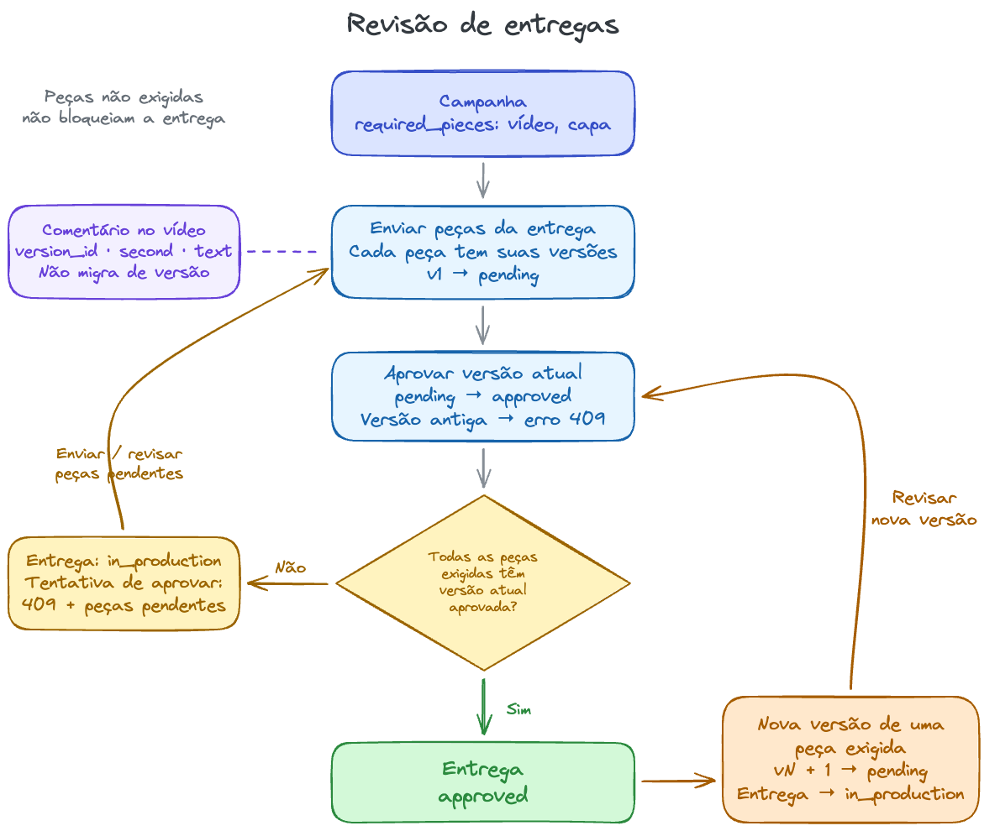

## Nota para quem avalia

Para ver o fluxo funcionando, rode `npm run demo`.

A entrega só fica aprovada quando a versão atual de cada peça exigida pela campanha está aprovada. Uma nova versão obrigatória desfaz essa aprovação até ser revisada. Peças opcionais não bloqueiam, e os comentários ficam na versão em que foram feitos. O status da entrega é calculado; o endpoint de aprovação apenas verifica as pendências.

O header opcional `Idempotency-Key` evita versões duplicadas ao repetir um envio. A chave fica salva por entrega e tipo de peça: os mesmos dados retornam a versão original; dados diferentes retornam `409`. Sem a chave, cada envio cria uma versão.

Vídeo e capa usam URLs, sem upload ou verificação dos arquivos. Não há interface, autenticação ou pagamento real.

Com mais tempo, eu faria:

- Upload dos arquivos e leitura automática da duração do vídeo
- Um player para clicar no comentário e ir direto ao trecho do vídeo
- Autenticação

Defini o escopo e a arquitetura e pedi à IA para implementar a solução e criar os testes e a demonstração

Revisei o bloqueio da aprovação quando há peças obrigatórias pendentes e a perda da aprovação ao enviar uma nova versão. Adicionei idempotência para evitar versões duplicadas em tentativas repetidas de envio



## Como rodar

Node 22 atualizado (22.13 ou superior).

```bash
npm ci
npm test
npm run typecheck
npm run dev
```

A API sobe em `http://127.0.0.1:3007`
O banco fica em `data/reviews.sqlite`

Depois de `npm ci`, rode a demonstração:

```bash
npm run demo
```

`src/demo.ts` cria uma campanha e tenta aprovar a entrega antes de enviar a capa. Depois de resolver essa pendência e aprovar a entrega, envia outra versão do vídeo. A entrega volta para produção e só fica aprovada após a revisão dessa versão. O comentário continua na versão antiga. Cada etapa imprime o resultado e confere a resposta da API.

A demonstração chama as rotas da própria API com SQLite em memória. Não precisa de servidor rodando nem de `jq`, não altera o banco local e encerra sozinha.

## Exemplos de requisições e respostas

Os exemplos usam `jq` para guardar os IDs e resumir as respostas. Execute na mesma sessão do terminal, com a API rodando. As URLs são fictícias.

Crie uma campanha que exige vídeo e capa e, em seguida, uma entrega para ela. As duas requisições retornam `201`. O servidor gera os IDs e as datas.

```bash
CAMPAIGN_ID=$(curl -s -X POST localhost:3007/campaigns \
  -H 'content-type: application/json' \
  -d '{"name":"Campanha de exemplo","required_pieces":["video","cover"]}' | jq -r '.id')

DELIVERY_ID=$(curl -s -X POST localhost:3007/deliveries \
  -H 'content-type: application/json' \
  -d "{\"campaign_id\":\"$CAMPAIGN_ID\",\"creator_id\":\"crt_ana\"}" | jq -r '.id')
```

Envie a primeira versão do vídeo, comente no segundo 12 e aprove essa versão.

```bash
VIDEO_V1=$(curl -s -X POST "localhost:3007/deliveries/$DELIVERY_ID/pieces/video/versions" \
  -H 'content-type: application/json' \
  -H 'Idempotency-Key: video-1' \
  -d '{"url":"https://example.com/video-v1.mp4","duration_seconds":30}' | jq -r '.id')

curl -s -X POST "localhost:3007/versions/$VIDEO_V1/comments" \
  -H 'content-type: application/json' \
  -d '{"second":12,"text":"Mostrar a embalagem."}' | jq '{second, text}'
# {"second":12,"text":"Mostrar a embalagem."}

curl -s -X POST "localhost:3007/versions/$VIDEO_V1/approve" | jq '{number, status}'
# {"number":1,"status":"approved"}

curl -s -X POST "localhost:3007/deliveries/$DELIVERY_ID/approve" | jq
```

A última requisição retorna `409`: o vídeo está aprovado, mas a capa ainda não foi enviada.

```json
{
  "error": "entrega tem peças obrigatórias pendentes",
  "pending_pieces": [{ "piece_type": "cover", "reason": "missing" }]
}
```

Se a peça existir, mas sua versão atual não estiver aprovada, o motivo será `not_approved`.

Ao enviar e aprovar a capa, a entrega fica completa.

```bash
COVER_V1=$(curl -s -X POST "localhost:3007/deliveries/$DELIVERY_ID/pieces/cover/versions" \
  -H 'content-type: application/json' \
  -d '{"url":"https://example.com/cover.jpg"}' | jq -r '.id')

curl -s -X POST "localhost:3007/versions/$COVER_V1/approve" | jq '{number, status}'
# {"number":1,"status":"approved"}

curl -s -X POST "localhost:3007/deliveries/$DELIVERY_ID/approve" | jq '{status, pending_pieces}'
# {"status":"approved","pending_pieces":[]}
```

Repetir o envio com a mesma chave retorna `200`, mantém o vídeo na versão 1 e preserva a aprovação da entrega.

```bash
curl -s -X POST "localhost:3007/deliveries/$DELIVERY_ID/pieces/video/versions" \
  -H 'content-type: application/json' \
  -H 'Idempotency-Key: video-1' \
  -d '{"url":"https://example.com/video-v1.mp4","duration_seconds":30}' | jq '{number, status}'
# {"number":1,"status":"approved"}
```

Uma nova versão do vídeo, com outra chave, desfaz a aprovação da entrega. A aprovação da capa permanece válida.

```bash
VIDEO_V2=$(curl -s -X POST "localhost:3007/deliveries/$DELIVERY_ID/pieces/video/versions" \
  -H 'content-type: application/json' \
  -H 'Idempotency-Key: video-2' \
  -d '{"url":"https://example.com/video-v2.mp4","duration_seconds":20}' | jq -r '.id')

curl -s "localhost:3007/deliveries/$DELIVERY_ID" | jq '{status, pending_pieces}'
# {"status":"in_production","pending_pieces":[{"piece_type":"video","reason":"not_approved"}]}

curl -s -X POST "localhost:3007/versions/$VIDEO_V1/approve" | jq
# 409: {"error":"só a versão atual pode ser aprovada"}

curl -s "localhost:3007/versions/$VIDEO_V1" | jq '.comments | map({second, text})'
# [{"second":12,"text":"Mostrar a embalagem."}]

curl -s "localhost:3007/versions/$VIDEO_V2" | jq '.comments'
# []

curl -s -X POST "localhost:3007/versions/$VIDEO_V2/approve" | jq '{number, status}'
# {"number":2,"status":"approved"}

curl -s "localhost:3007/deliveries/$DELIVERY_ID" | jq '{status, pending_pieces}'
# {"status":"approved","pending_pieces":[]}
```

`GET /deliveries/:id` lista as peças e indica quais são obrigatórias, com a versão atual e o histórico de versões e comentários. `GET /campaigns/:id` retorna as exigências da campanha. Para verificar se a API está respondendo, use `GET /health`.

Para roteiro ou legenda, use a mesma rota de versões com `script` ou `caption` e envie `{"content":"Texto da peça."}`. Para uma campanha só de vídeo, crie `required_pieces: ["video"]`: roteiro, capa e legenda não serão exigidos, mesmo se houver versões opcionais pendentes.
